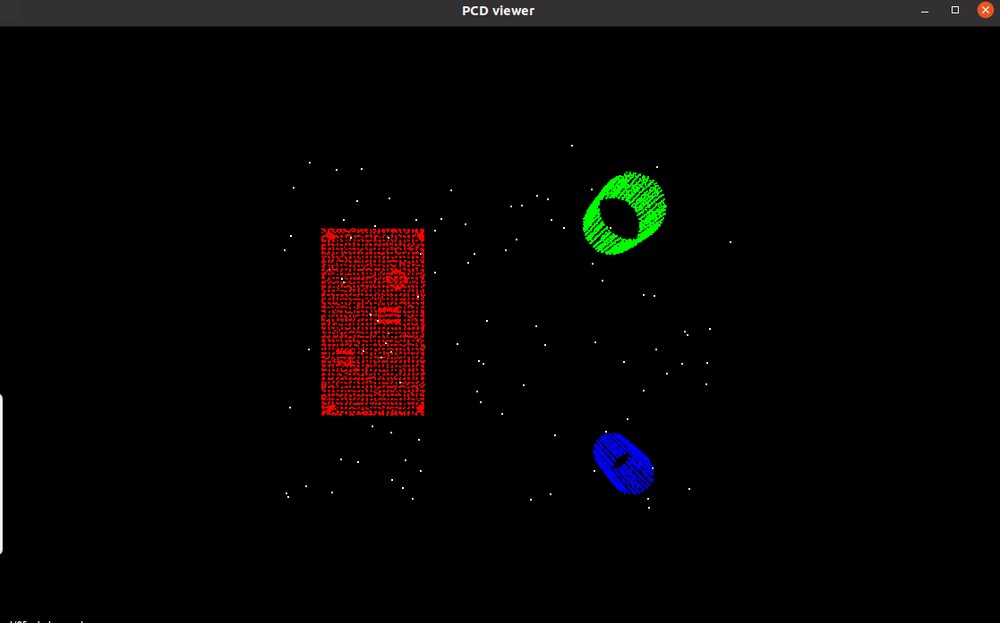

# 3.5 聚簇 练习记录

对应源码：`src/tutorial_pcl_basic/src/05_cluster.cpp`
运行环境：Ubuntu / ROS / PCL，zsh

## 一、任务目标

把灰蒙蒙一张点云，按**空间连接关系**分组，每组染一种颜色，存成彩色点云。

欧式聚类只看"点挨不挨着"，不懂"这是桌子还是柱子"。所以：

- 地面、天花板、外墙会把本来无关的东西连成一片（桌腿落在地面上，两点很近），必须先用 `CropBox` 裁掉。
- 从一个点出发，找容差内的邻居，再从邻居继续找，直到没有新点。一簇的首尾可以相距很远，只要中间有点一路连过去。
- 桌上零件如果接触桌面，会被并进桌子那一堆——这不是错误，算法判断的就是连接关系。

## 二、整体流水线

```
读点云 → 降采样 → 裁区域 → 聚类拿下标 → 打印中心 + 染色 → 存彩色点云
```

`main` 里先降采样（112400 → 70003）再裁剪（→ 7833），点少几倍，聚类反复找邻居就快几倍。

## 三、补全内容

本节只需补两个函数，`downsample` 和 `region` 已经写好当示例。

### 1. `cluster` —— 欧式聚类

```cpp
pcl::search::KdTree<pcl::PointXYZI>::Ptr tree(new pcl::search::KdTree<pcl::PointXYZI>);
tree->setInputCloud(cloud);

pcl::EuclideanClusterExtraction<pcl::PointXYZI> ec;
ec.setInputCloud(cloud);
ec.setSearchMethod(tree);
ec.setClusterTolerance(0.12);
ec.setMinClusterSize(50);
ec.setMaxClusterSize(10000);
ec.extract(clusters);
```

- 建 KdTree 是为了让"找 0.12m 内的邻居"从 O(N²) 降到 O(N log N)。每扩展一个点都要查一次邻居，树省的就是这里的时间。
- **树和 `ec` 必须喂同一份 `cloud`**，否则树里的下标对不上输入点云，结果全乱。讲义专门强调过这点。
- `setClusterTolerance(0.12)` 是连接距离，不是物体大小：两点距离小于 12cm 就算相连，限制的是相邻两点，不是整堆直径。
- `setMinClusterSize(50)` / `setMaxClusterSize(10000)` 是点数门槛：小于下限、大于上限的堆都被**丢弃**，不会拆开。当前数据最大一堆 3974 点，上限留了 2 倍余量。
- `extract(clusters)` 是真正干活的，结果写进 `clusters`——注意输出是 `vector<PointIndices>`（一堆下标），不是点云。
- 要传 `pcl::search::KdTree`，不能传 `pcl::KdTreeFLANN`（老体系，没继承 `Search` 接口，类型不匹配）。

### 2. `clusterCenter` —— 算一堆的点数和中心

```cpp
std::size_t count = one.indices.size();
pcl::compute3DCentroid(*cloud, one.indices, centroid);
return count;
```

- `one` 是函数形参，类型是 `const pcl::PointIndices&`，由 `describeClusters` 调用时传进来：循环里 `clusterCenter(cloud, clusters[c], centroid)`，`clusters[c]` 就是这一堆的下标集合。
- `PointIndices` 本质是装 `int` 的容器，`one.indices.size()` 就是这堆的点数。
- `compute3DCentroid` 三个参数：点云、下标、输出向量。第一个参数签名要 `const PointCloud&`，所以 `*cloud` 要解引用（参数本身是 `ConstPtr` 指针）。第二个参数用 `one.indices`，表示只用这堆的点算。
- 结果写进四维向量 `centroid`：前三分量 x/y/z，第四分量固定 1。打印由 `describeClusters` 负责，只打印前三个。
- 函数返回点数，不是中心——中心从引用参数 `centroid` 拿。

## 四、下标这条线

`extract` 填进 `clusters` 的只有整数（点的编号），没有一个坐标。后面两处用它：

- `clusterCenter`：拿 `one.indices` 让 `compute3DCentroid` 只对这批下标求平均。
- `colorClusters`：拿 `clusters[c].indices` 把 `colored[idx]` 改成堆的颜色。

存下标不存点坐标，好处是省内存、多个函数共用一套结果；代价是要记住**下标属于哪张点云**。这里 `describeClusters` 和 `colorClusters` 第一个参数都传 `cropped`，就是保证参照系一致——拿这些下标去索引原始 112400 点的 `demo_room.pcd` 必然错位。

`colorClusters` 先把所有点刷白，再按堆改色：白色 = 没进任何堆（点数不到 50 或超过 10000）。

## 五、参数

| 参数 | 本节取值 | 调整时观察什么 |
| --- | --- | --- |
| 体素边长 `leaf` | 0.05 m | 改大点变少，每堆点数也变少 |
| 裁剪范围 | x[1.6,6.6] y[1.0,5.0] z[0.2,2.4] | z 下限切地面，上限切天花板横梁 |
| 连接容差 | 0.12 m | 0.02 桌子碎成多片，0.5 桌子柱子粘一起 |
| 最少点数 | 50 | 调高排除小簇，也可能排除远处目标 |
| 最多点数 | 10000 | 超过上限的堆被丢弃，不拆开 |

容差至少要大于降采样后的点间距，否则同一物体自己就断了。`leaf` 翻倍，容差大致也要翻倍（07 流水线用 `leaf=0.10` 配 `tolerance=0.20`，就是这个道理）。点数阈值跟数据密度绑定，没有跨数据集通用的值。

## 六、运行结果

命令：

```shell
./run 5
pcl_viewer out/05_clusters.pcd
```

讲义示例：

```
输入点数: 112400
降采样后点数: 70003
裁剪后点数: 7833
分出 3 堆
堆 0: 3974 点, 中心 (2.61153, 3.11056, 0.731429)
堆 1: 2397 点, 中心 (5.50085, 4.30166, 1.30253)
堆 2: 1364 点, 中心 (5.49915, 1.50049, 1.30763)
存到 out/05_clusters.pcd
```

**我实测的结果：**

```
输入点数: 112400, 排除无效坐标 0 点
降采样后点数: 70003
裁剪后点数: 7833
按距离把点分组
分出 3 堆
堆 0: 3974 点, 中心 (2.61153, 3.11056, 0.731429)
堆 1: 2397 点, 中心 (5.5085, 4.30166, 1.30253)
堆 2: 1364 点, 中心 (5.49915, 1.50049, 1.30763)
存到 /home/airhust/airhust_tutorial2026_ws/3关/airhust_tutorial26_pcl_ws/out/05_clusters.pcd
```

和讲义示例一致：点数、堆数、三堆点数、中心坐标都对得上（堆 1 中心 x 的末位 5.5085 与讲义 5.50085 有极微小差异，不影响结果）。`排除无效坐标 0 点` 说明这份 PCD 数据干净，`按距离把点分组` 是 TODO 1 里那行 `std::cout`，看到它就说明 `extract` 那段确实跑到了。

**聚类结果截图（`pcl_viewer out/05_clusters.pcd`）：**



看图检查：左边红色一整块是桌子，右上绿色和右下蓝色是两根柱子，中间和四周的白色散点是没进任何堆的噪声。三种颜色各自成团，没有把桌子和柱子染成一团。

各堆点数之和可以小于裁剪后的点数：3974 + 2397 + 1364 = 7735 < 7833，差 98 点。这些是被 50 下限或 10000 上限排除的噪声——点数对不上是正常的。

## 七、思考题

**1. 为什么桌面上的零件可能与桌子属于同一簇？**

接触处两点距离小于容差，有路径一路连过去，算法就判为一簇。它判断连接关系，不判断物体身份。

**2. 体素尺寸增大后，最少点数是否还适合保持不变？**

不适合。`leaf` 变大 → 点变稀 → 每堆点数变少 → 原来 50 的门槛可能把整堆排除，要调低。

## 八、遇到的问题

### 概念上的几个坎

- **`one` 从哪来**：它不是在函数里创建的，是函数形参，值由 `describeClusters` 调用时传的 `clusters[c]` 决定。讲义那段 `pcl::PointIndices one = clusters[0];` 是另起的一个局部变量，写死第一堆，和 TODO 里的形参只是类型、名字一样，来源不同。
- **`extract` 的输出不是点云**：它只给一堆整数下标。点云要自己按 `cloud->points[idx]` 取，或用 `copyPointCloud`。
- **`setIndices` 的边界**：它只限制"处理谁"，不限制"邻居从哪找"。SOR 查邻居仍用完整输入点云，别的簇的点也可能成为邻居。想只在簇内找邻居，得先 `copyPointCloud` 出子点云，再把子点云设为输入。

### 常见报错

| 现象 | 原因 | 处理 |
| --- | --- | --- |
| `no matching function for setSearchMethod` | 传了 `pcl::KdTreeFLANN` | 用 `pcl::search::KdTree` |
| `extract` 报下标越界 | tree 和 ec 的输入不是同一份点云 | 两处都写 `cloud` |
| `invalid initialization of reference` | `compute3DCentroid` 传了 `cloud` 没解引用 | 写 `*cloud` |
| `no member named 'indices'` | `one` 写成了指针 | `one` 是引用，写 `one.indices` |
| 分出 0 堆 | 容差太小 / 裁剪把目标切没了 | 先看"裁剪后点数"是否为 7833，再试 0.5 容差 |
| 全挤成 1 堆 | 容差太大 | 调回 0.12，检查 `region` 的 z 下限 |
| 终端只有"分出 3 堆"没细节 | TODO 2 没做，`count` 恒为 0，`describeClusters` 里 `continue` 跳过了 | 补 `one.indices.size()` 那两行 |

## 九、小结

这一节的新东西只有两个：聚类类 `EuclideanClusterExtraction` 和质心 `compute3DCentroid`。调用套路还是老一套——`setInputCloud` → 设参数 → 执行（`extract` / `filter`），结果靠引用参数传出去。模板参数必须和点云类型一致（`PointXYZI`）。

下标是这一节的隐藏主线：聚类产出下标，打印和染色消费下标，全程要盯着"下标属于哪张点云"。
