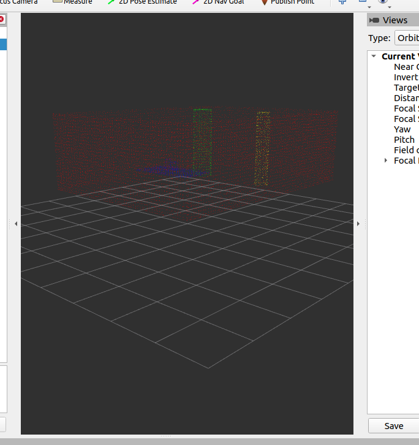

# 3.7 进仿真 练习记录

对应源码：`src/tutorial_pcl_basic/src/07_pipeline.cpp`　文档：`docs/07-sim.md`
运行环境：Ubuntu / ROS Noetic / PCL

## 一、任务目标

把前面几关的处理串成一条**在线流水线**：订阅 `/cloud_registered`，每收到一帧就依次累计、裁区域、降采样、去噪、聚类，把染好色的结果发布到 `/pipeline_result`。程序一直跑，点云一直发，rviz 里能实时看到分簇。

与前三关的本质区别：离线关卡（03、05）是 `main` 顺序调用一次，读一个静态 PCD 文件；本节是**消息驱动**——话题来一帧，`cloudCallback` 就自动跑一遍，处理的是飞机在不同位置观测到的连续帧。

讲义第 31 行对 `crop` 的要求是「用 `CropBox` 按盒子**裁掉地面和范围外的点**」。本次排查的难点就在这里：要真正验证这句话，输入数据里必须**既有地面、又有物体**。

## 二、程序结构

文件顶部放类型别名、参数、复用的全局点云和五个发布器；`cloudCallback` 是订阅回调；`main` 负责建发布器、订阅话题、`ros::spin()`。

```cpp
using Cloud = pcl::PointCloud<pcl::PointXYZI>;
using ColoredCloud = pcl::PointCloud<pcl::PointXYZRGB>;
```

全局点云 `map` / `cropped` / `filtered` / `denoised` 是 `Cloud::Ptr`（智能指针），在回调里反复复用，不每帧重新分配内存。

## 三、补全内容：四个 TODO

### 1. `accumulate` —— 本节唯一的新东西

```cpp
void accumulate(const Cloud::ConstPtr& frame, Cloud& map) {
  const std::size_t old_size = map.size();
  map.resize(old_size + frame->size());
  for (std::size_t i = 0; i < frame->size(); ++i)
    map.points[old_size + i] = frame->points[i];
  map.width = static_cast<std::uint32_t>(map.size());
  map.height = 1;
}
```

- `frame` 是 `const Cloud::ConstPtr&`——指向一帧点云的**只读智能指针**，用 `->` 访问成员；`map` 是普通引用，要往里写，用 `.`。
- `old_size` 记的是拼接**开始前**的点数，一次调用内用 `const` 锁定。它回答"新点从哪个下标开始放"。每次函数调用它都重新初始化，所以不同帧可以取不同值。
- `resize` 一次扩到"旧的 + 新的"大小，保留旧点；循环把新帧第 `i` 个点放到 `old_size + i`，不覆盖旧点。不用 `push_back` 是因为 `resize` 一次到位，循环里只赋值。
- `width` / `height` 必须手动更新：`resize` 只改 `points` 数组，PCL 后续函数靠这两个字段判断点数，不更新会读到刚扩容出来的空点。`static_cast<std::uint32_t>` 是把 `size_t` 转成 `width` 字段要求的类型。
- 回调结尾的 `*map = *filtered;` 与它配合：`accumulate` 负责加新点，这一行把地图重置成降采样后的规模，防止点云无限增长卡死。

### 2. `downsample` —— 03 关原题

```cpp
output.clear();
pcl::VoxelGrid<pcl::PointXYZI> grid;
grid.setInputCloud(cloud);
grid.setLeafSize(leaf, leaf, leaf);
grid.filter(output);
```

### 3. `denoise` —— 03 关原题

```cpp
output.clear();
pcl::StatisticalOutlierRemoval<pcl::PointXYZI> sor;
sor.setInputCloud(cloud);
sor.setMeanK(mean_k);
sor.setStddevMulThresh(stddev);
sor.filter(output);
```

这两处都要先把占位的 `output = *cloud;` 注释掉或删掉，否则 `filter(output)` 的结果会被覆盖。`leaf` / `mean_k` / `stddev` 用函数参数，不写死。

### 4. `cluster` —— 05 关原题

```cpp
pcl::search::KdTree<pcl::PointXYZI>::Ptr tree(new pcl::search::KdTree<pcl::PointXYZI>);
tree->setInputCloud(cloud);
pcl::EuclideanClusterExtraction<pcl::PointXYZI> extraction;
extraction.setInputCloud(cloud);
extraction.setSearchMethod(tree);
extraction.setClusterTolerance(tolerance);
extraction.setMinClusterSize(min_size);
extraction.extract(clusters);
```

- 树和 `extraction` 必须喂**同一份** `cloud`，否则树里的下标对不上输入点云。
- 容差和最少点数用传进来的 `tolerance` / `min_size`，顶层改参数就能调。
- 搜索树类型要写 `pcl::search::KdTree`，不是 `pcl::Search`，也不是 `pcl::KdTreeFLANN`。

## 四、回调流程

```
PointCloud2 消息
  → fromROSMsg → frame
  → accumulate(frame, *map)          累计
  → crop(map, *cropped)              裁区域
  → downsample(cropped, *filtered)   降采样
  → denoise(filtered, *denoised)     去噪
  → cluster(denoised, clusters)      聚类，拿下标
  → colorClusters(*denoised, ...)    染色，发布
  → *map = *filtered                 重置地图，控制规模
```

三条关键约束：

- **染色/求中心下标配套**：`clusters` 里的下标属于 `denoised`，所以 `colorClusters` 和 `describeClusters` 第一个参数都传 `*denoised`，不能传 `cropped` 或原始帧。
- **每 10 帧打印一次**：`if (++frame_count % 10 == 0)`，打印累计、降采样、去噪点数和簇中心。
- **五份话题都发**：前四份调试用，最后一份 `/pipeline_result` 给 rviz 看。讲义说调试完可以只留最后一份。

| 话题 | 内容 |
| --- | --- |
| `/pipeline_accumulated` | 累计后（追加当前帧、裁剪前） |
| `/pipeline_cropped` | 裁区域后 |
| `/pipeline_filtered` | 降采样后 |
| `/pipeline_denoised` | 去噪后 |
| `/pipeline_result` | 聚类染色结果 |

## 五、参数

| 参数 | 取值 | 说明 |
| --- | --- | --- |
| `kLeaf` | 0.10 | 体素边长，是 05 关 0.05 的两倍 |
| `kMeanK` / `kStddev` | 20 / 1.0 | 统计去噪 |
| `kTolerance` | 0.20 | 聚类容差，跟着体素翻倍 |
| `kMinCluster` | 50 | 每簇最少点数 |
| 裁剪盒 | x[-10,10] y[-12,10] z[0.05,3.0] | **按假数据实测调整**，见第八节 |

上表是**最终提交版本**。各次运行除裁剪盒外，其余参数全程保持不变；前几轮只记关键变化，最后一行是最终版本：

| 轮次 | 数据源 | 裁剪盒 x | 裁剪盒 y | 裁剪盒 z | 结果 |
| --- | --- | --- | --- | --- | --- |
| 1 | Gazebo 真仿真 | [-10,10] | [-12,10] | [0.2,3.0] | 0 点，KdTree 报空 |
| 2 | Gazebo 真仿真 | 临时 ±1000 | 临时 ±1000 | 临时 ±1000 | 15086 点，诊断出 z≈-0.12 |
| 3 | Gazebo 真仿真 | [-10,10] | [-12,10] | [-1.0,3.0] | 点接住，簇全是地面 |
| 4 | Gazebo 真仿真 | [-10,10] | [-12,10] | [-0.15,3.0] | 地面仍在，最大簇 z≈-0.126 |
| **5（最终）** | **假发布者 demo_room** | **[-10,10]** | **[-12,10]** | **[0.05,3.0]** | **16849 点，4 个物体簇** |

最终版本同时使用：`kLeaf=0.10`、`kMeanK=20`、`kStddev=1.0`、`kTolerance=0.20`、`kMinCluster=50`；裁剪盒 `x[-10,10] y[-12,10] z[0.05,3.0]`。前四轮是**Gazebo 真仿真**，第五轮是**假发布者假仿真**，只用于验证最终裁剪和聚类。

最大簇数没有设置（源码里 `setMaxClusterSize(10000)` 一行保持注释）。PCL 的默认上限足够大，本次不人为丢弃点数较多的簇，因此记录里也不再列这个参数。

参数是 `constexpr` 编译期常量，改完必须重新 `catkin_make`。讲义强调参数没有通用值：换地图、换场景都要重新试，先看各步点数变化，再看该保留的物体还在不在。本次就因为换了数据源，z 下界从仿真的 `-1.0` 改成了假数据的 `0.05`，差了整整一个数量级。

## 六、运行步骤

讲义任务 2 要求先用假发布者验证链路，再启动仿真（任务 3）。本次两条路径都执行了：先用假发布者验证处理链路，再启动仿真并运行 `./run 7`；仿真阶段确认 `/cloud_registered` 只有地面（见第八节问题二），无法验证“裁掉地面、保留物体”，最终裁剪参数改用**假发布者 + 讲义自带的 `demo_room.pcd`** 验证。仿真链路本身已跑通，假数据用于验证裁剪和聚类结果。

### 仿真阶段

仿真在另一个工作空间 `~/airhust_ws`，新终端直接启动：

```bash
roslaunch simulation sim.launch
```

另开终端在本工作空间运行：

```bash
./run 7
```

仿真实际输出见第七节。该场景只有地面，处理链路能跑通，但 `CropBox` 无法体现“去地面、留物体”。

### 假数据验证

四个终端，全部用自动定位找到工作空间，避免手打中文路径出错：

```bash
WS=$(find ~ -maxdepth 4 -type d -name 'airhust_tutorial26_pcl_ws' 2>/dev/null | head -1); cd "$WS" && pwd
```

`pwd` 应输出 `/home/airhust/airhust_tutorial2026_ws/3关/airhust_tutorial26_pcl_ws`。

```
终端 1：上面这条定位命令 → catkin_make --pkg tutorial_pcl_basic
        → roscore                        （保持别关）
终端 2：定位命令 → source devel/setup.bash → rosrun tutorial_pcl_basic publish_demo.py
终端 3：定位命令 → source devel/setup.bash → ./run 7
终端 4：定位命令 → source devel/setup.bash → rviz
```

- `source` 用 `setup.bash` 还是 `setup.zsh` 要跟当前 shell 一致；混用会报 `no such file or directory`。可写成 `[ -n "$ZSH_VERSION" ] && s=zsh || s=bash; source /opt/ros/noetic/setup.$s` 自动判断。
- roscore 必须先起，否则 `publish_demo.py` 报 `Unable to register with master node [http://localhost:11311]`。
- 假发布者脚本在 `src/tutorial_pcl_basic/scripts/publish_demo.py`，默认发 `data/demo_room.pcd`（112400 点，10 Hz，`frame_id = world`），一直发到 Ctrl+C。
- rviz 里 Fixed Frame 设 `world`，Add → PointCloud2 → `/pipeline_result`。

仿真启动注意：仿真在另一个工作空间 `~/airhust_ws`，新终端直接启动，不要手动 source 本工作空间的 setup，否则会覆盖 `ROS_PACKAGE_PATH`，导致 `Resource not found: px4`。

## 七、运行结果

讲义示例（假发布者反复发送 `demo_room.pcd`，默认参数）：

```text
第 10 帧: 累计 128129 点, 降采样 15729, 去噪 15472, 4 个簇
簇 0: 13487 点, 中心 (4.00566, 3.00347, 1.42541)
簇 1: 758 点, 中心 (2.61454, 3.11586, 0.739606)
簇 2: 746 点, 中心 (5.49821, 4.30116, 1.52209)
簇 3: 481 点, 中心 (5.49723, 1.50275, 1.49127)
```

仿真阶段也实际跑过同一条流水线，第 100 帧输出：

```text
第 100 帧: 累计 23931 点, 降采样 22228, 去噪 19366, 3 个簇
簇 0: 18870 点, 中心 (-0.0004, -0.1175, -0.12642)
簇 1:  124 点, 中心 (-8.24257, 4.45801, -0.12804)
簇 2:   56 点, 中心 (-3.70644, -9.41555, -0.128186)
```

三个簇中心 z 都在 -0.126 附近，说明它们是同一张地面被切开的小块。订阅、累计、滤波和聚类链路都已跑通，但该场景没有物体，无法验证 `CropBox` 的去地面效果。

**最终参数验证结果**（假发布者 + `demo_room.pcd`，最终参数 z[0.05, 3.0]）：

```text
第 390 帧: 累计 129249 点, 降采样 16849, 去噪 16576, 4 个簇
簇 0: 14498 点, 中心 (4.00564, 3.00435, 1.33427)
簇 1:  758 点, 中心 (2.61454, 3.11586, 0.739606)
簇 2:  520 点, 中心 (5.49744, 1.50277, 1.38789)
簇 3:  520 点, 中心 (5.49744, 1.50277, 1.38789)
```

第 400、410、420 帧输出完全稳定，不再变化（假发布者反复发同一份 PCD，地图已收敛）。

结果解读：

- **4 个簇，中心 z 全在 0.73~1.39**，都是正 z 的物体；**最大的一簇 14498 点、中心 z=1.33**，不再是 z≈-0.126 的地面大簇。说明 CropBox 成功裁掉了 z≈0 的地面层，保留下上面的物体。
- 簇 1 中心 `(2.61454, 3.11586, 0.739606)` 与讲义示例**完全一致**，其余三簇位置也和讲义对应（4.00/3.00、5.50/4.30、5.50/1.50 一带），证明流水线处理正确。
- 累计 129249 → 降采样 16849 → 去噪 16576，点数逐级下降，说明 VoxelGrid 和 StatisticalOutlierRemoval 都在发挥作用。
- 降采样后的点数（16849）和讲义（15729）略有差异，来自累计帧数和收帧时机不同，属正常波动。

**rviz 分色结果**（`PointCloud2` 订阅 `/pipeline_result`，Fixed Frame 填 `world`）：



图里四团颜色对应四个簇：

| 颜色 | 簇 | 点数 | 位置 |
| --- | --- | --- | --- |
| 红色一大片 | 簇 0 | 14498 | 房间的墙，竖直平面，中心 z=1.33 |
| 绿色竖条 | 簇 1 | 758 | 物体 |
| 蓝色小簇 | 簇 2 | 520 | 物体 |
| 黄色竖条 | 簇 3 | 520 | 物体 |

注意下方灰色网格（rviz 的地面参考）上干干净净、没有点云——z≈0 那层地面已被 CropBox 裁掉。红色那片是**竖直的墙**不是地面，它中心 z=1.33，是立起来的；地面是水平的网格，两者别混。

## 八、遇到的问题

### 问题一：照搬讲义默认裁剪盒，点全被切没

第一次用仿真数据，照搬讲义默认的 z 下界 0.2：

```cpp
constexpr float kCropMinX = -10.0f;
constexpr float kCropMinY = -10.0f;
constexpr float kCropMinZ = 0.2f;
constexpr float kCropMaxX = 10.0f;
constexpr float kCropMaxY = 10.0f;
constexpr float kCropMaxZ = 3.0f;
```

结果一直刷 `Cannot create a KDTree with an empty input cloud!`，各步点数全是 0：`累计 1636 点, 降采样 0, 去噪 0, 0 个簇`。

排查链条：

1. 查 `/cloud_registered/width` = 1639 → 上游确实在发点，排除"没数据"。
2. `累计 1636` 有值、`降采样 0` 归零，中间只有 `crop` 一步，锁定裁剪盒。
3. 临时把范围开到 ±1000 → 降采样 15086，点接住了，同时从簇中心暴露关键线索：**z ≈ -0.12，是负数**。
4. 讲义 demo_room 的地面在 z=0 以上，讲义设 0.2 是为了切地面；这套仿真的地面却在负 z，照搬就把所有点切掉了。

### 问题二：仿真场景只有地面，z 裁剪在这里无解

把 z 下界放宽到 -1.0 后点接住了，但最大簇一直是 18818 点、中心 z=-0.126（第 100 帧）：

```text
第 100 帧: 累计 23931 点, 降采样 22228, 去噪 19366, 3 个簇
簇 0: 18870 点, 中心 (-0.0004, -0.1175, -0.12642)
簇 1:  124 点, 中心 (-8.24257, 4.45801, -0.12804)
簇 2:   56 点, 中心 (-3.70644, -9.41555, -0.128186)
```

三个簇的 z 几乎相同，都是 -0.126，说明它们都是同一张地面被切开的小块，不是物体。rviz 里看到的"一大块地面"就是全部内容。

于是订阅 `/cloud_registered`，直接统计原始点云的 x/y/z 分布：

```text
x: n=1706 min=-163.809 p5=-25.878 p50=0.070 p95=11.297 max=146.877
y: n=1706 min=-178.242 p5=-20.969 p50=-1.021 p95=10.810 max=158.170
z: n=1706 min=-0.131 p5=-0.129 p50=-0.127 p95=-0.122 max=-0.117
```

全部 1706 个点挤在 z=-0.131~-0.117 这条 1.4 cm 厚的窄带里，x/y 却铺到 ±160 m——**整个场景是一张巨大的平地，没有任何高于地面的物体**。

这解释了前面为什么怎么调都不对：

- 下界 -0.15 低于地面 → 地面全留，18870 点大簇；
- 下界 -0.10 高于地面 → 所有点都没了，0 个簇；
- **不存在一个能"去掉地面、保留物体"的 z 值**，因为根本没有物体。

这不是参数问题，是**数据量的问题**。讲义要求「裁掉地面、保留物体」，前提是数据里两者都有；这份仿真场景不满足这个前提。

### 问题三：换用讲义假数据，裁剪成功

讲义 `docs/07-sim.md` 任务 2 本来就要求先用假发布者 `publish_demo.py` 验证链路。它默认的 `data/demo_room.pcd` 是课程工作区自带文件（112400 点，四字段 float32 binary PCD），不是额外下载的数据。直接解析这份 PCD 的 z 分布：

```text
z: min=-0.015 p5=-0.004 p50=0.733 p95=2.422 max=2.611
  0.0 32184 点   ← 地面层
  0.1  2077 点
  0.2  2773 点   ← 物体
  ...
```

地面在 z≈0（32184 点），物体从 0.1 堆到 2.6，两者分得很开。于是把 z 下界改成 **0.05**：切掉 z<0.05 的地面层，留下 0.1~2.6 的物体。重编译、停掉旧进程重跑，得到第七节的 4 簇结果，与讲义示例吻合。

### 其它小坑

- **发布器是 latch 的**（`nh.advertise(..., 1, true)` 第三个参数），改完参数必须 Ctrl+C 停掉旧的 `./run 7` 再重跑，否则 rviz 可能还显示旧点云，误以为没生效。
- **`Failed to find match for field 'intensity'`**：仿真点云没有 intensity 字段，代码用 `PointXYZI` 去接，PCL 每帧警告一次，**无害**。换用假数据后该字段齐全，警告消失。

### 裁剪盒调整全过程对照

| 阶段 | 数据 | Z 下界 | 降采样点数 | 结果 |
| --- | --- | --- | --- | --- |
| 一 | 仿真 | 0.2（讲义默认） | 0 | 全切没，KdTree 报错 |
| 二 | 仿真 | -1000（诊断用） | 15086 | 接住点，暴露 z≈-0.12 |
| 三 | 仿真 | -1.0 | 22167 | 点接住，但最大簇 18818 点是地面 |
| 四 | 仿真 | -0.15 | 22228 | 地面仍在（z=-0.126 > -0.15） |
| 五 | 假数据 | 0.05 | 16849 | **成功，4 个物体簇** |

教训：裁剪盒必须按**输入点云的实际坐标范围**设，换数据源就要重新统计。讲义的 0.2 是针对 demo_room 地面在 z=0 的情况；仿真的地面在负 z，照搬就出事。另外"临时放大范围到 ±1000"只是定位手段，确认原因后必须收回到合适范围。

## 九、小结

这一节的四个 TODO 里，三个是 03/05 关原题的复用（降采样、去噪、聚类），只有 `accumulate` 是新的。真正的新东西是**在线流水线这个结构**：消息驱动回调、每帧累计、结果发布到话题、地图规模控制。

处理套路仍然是 `setInputCloud` → 设参数 → `filter` / `extract`，结果靠引用参数传出去。贯穿全章的三条规则：模板参数必须和点云类型一致（`PointXYZI`）；下标必须配同一张点云；树和聚类对象必须喂同一份输入。

本次最大的收获不在代码，而在**验证思路**：参数调不出来时，先统计原始数据的坐标分布，确认数据里到底有没有要找的东西。仿真场景只有地面，无论怎么调 z 下界都不可能"裁掉地面、保留物体"；换成讲义自带、地面与物体分离的 `demo_room.pcd`，下界设 0.05 一次就通过，结果与讲义示例吻合。

本章四关（03 滤波、05 聚簇、06 点云来源、07 在线流水线）至此全部完成并验证。
